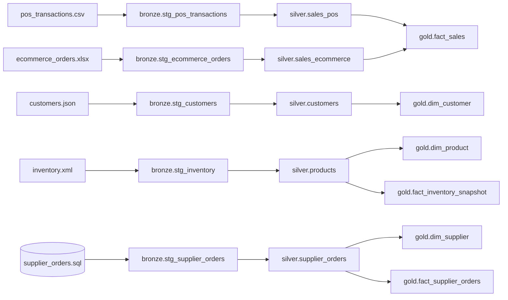
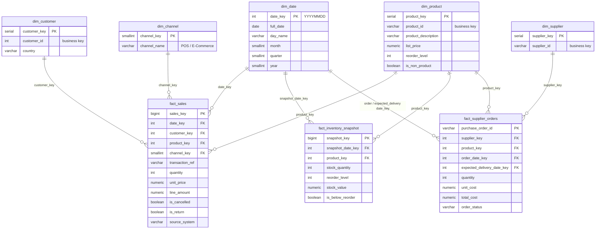

# Star Schema – ERDP Gold Layer

**Sprint 2 deliverable** · Schema: `gold` · DDL: `sql/04_gold_star_schema.sql` · Load: `sql/05_gold_load_queries.sql`

## 1. Data flow (Medallion)

## 2. Star schema

## 3. Tables

| Table | Type | Grain (one row = …) | Source (Silver) | Rows |
|---|---|---|---|---|
| dim_date | Dimension | one calendar day | generated from min–max dates in all sources | 5,806* |
| dim_customer | Dimension | one customer | silver.customers | 323 + Unknown |
| dim_product | Dimension | one product | silver.products | 1,988 + Unknown |
| dim_supplier | Dimension | one supplier | silver.supplier_orders | 80 + Unknown |
| dim_channel | Dimension | one sales channel | fixed values | 2 |
| fact_sales | Fact | one sales line (POS or online) | silver.sales_pos + silver.sales_ecommerce | 14,755 |
| fact_inventory_snapshot | Fact (periodic snapshot) | one product's stock on the load date | silver.products | 1,982 |
| fact_supplier_orders | Fact | one purchase order | silver.supplier_orders | 2,000 |

\* dim_date grows with the run date, because the snapshot date is "today".

## 4. Design decisions
- **Surrogate keys** (`*_key`) in every dimension; source IDs are kept as business keys for lineage.
- **Unknown member (key = -1)** in every dimension. Sales without a customer (2,291 POS + 1,141 online lines) point to customer −1 instead of NULL, so no fact row is lost.
- **One fact_sales for both channels** with `dim_channel`, so store and online sales can be compared directly.
- **Cancellations and returns are kept and flagged** (`is_cancelled`, `is_return`), not deleted, so refunds can be reported. KPI queries filter them out.
- **Non-product codes** (POST, DOT, C2, M, D, BANK CHARGES) are flagged `is_non_product` and excluded from product KPIs.
- **No store or warehouse dimension:** the UC3 source files do not contain store or warehouse identifiers.
- **Lineage columns:** `fact_sales.source_system` + `source_line_id` point back to the Silver row; Silver keeps `source_file`.
