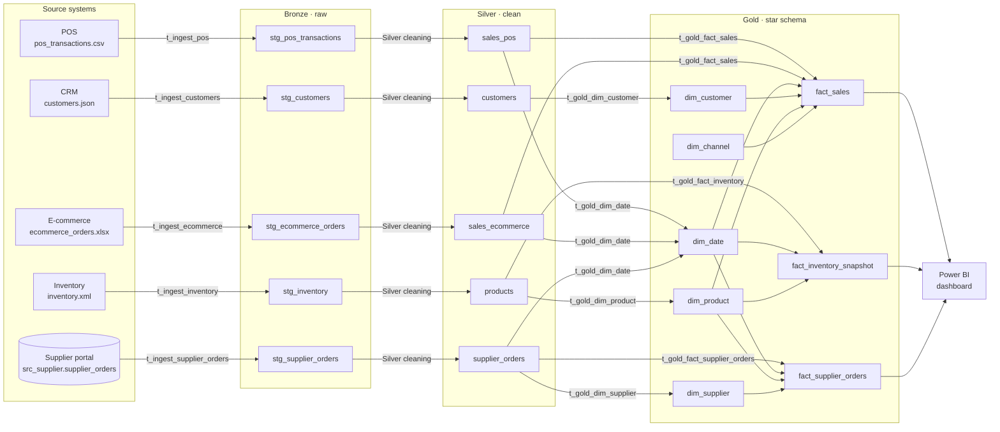

# Data Lineage – ERDP

**Sprint 3 deliverable** · How data moves from each source system to the Power BI dashboard, which component moves it, and how any warehouse row can be traced back to its source.

## 1. End-to-end lineage



## 2. Pipeline inventory

| Order | Component | Type | Reads | Writes | Load style |
|---|---|---|---|---|---|
| 1 | t_ingest_pos | Pentaho transformation (CSV file input) | pos_transactions.csv | bronze.stg_pos_transactions | Truncate + insert |
| 2 | t_ingest_ecommerce | Pentaho transformation (Microsoft Excel input) | ecommerce_orders.xlsx | bronze.stg_ecommerce_orders | Truncate + insert |
| 3 | t_ingest_customers | Pentaho transformation (JSON input) | customers.json | bronze.stg_customers | Truncate + insert |
| 4 | t_ingest_inventory | Pentaho transformation (Get data from XML) | inventory.xml | bronze.stg_inventory | Truncate + insert |
| 5 | t_ingest_supplier_orders | Pentaho transformation (Table input) | src_supplier.supplier_orders | bronze.stg_supplier_orders | Truncate + insert |
| 6 | Silver cleaning | Pentaho job SQL entry | bronze.* | silver.* | Drop + rebuild |
| 7–10 | t_gold_dim_date / customer / product / supplier | Pentaho transformations (Table input → Table output) | silver.* | gold.dim_* | Insert new keys only |
| 11–13 | t_gold_fact_sales / inventory / supplier_orders | Pentaho transformations | silver.* + gold.dim_* | gold.fact_* | Truncate + insert |
| — | j_erdp_master | Pentaho job | — | runs 1–13 in order, aborts on failure | — |
| — | profile_bronze.py | Python (Pandas) | bronze.* | docs/Data_Profiling_Report.md, docs/Data_Quality_Report.md | Overwrite |

## 3. Tracing a warehouse row back to its source

Every layer keeps the information needed to walk backwards:

| From | Use | To |
|---|---|---|
| gold.fact_sales | `source_system` + `source_line_id` | silver.sales_pos.pos_line_id or silver.sales_ecommerce.ecom_line_id |
| silver.sales_pos | `invoice_no` + `product_id` + `invoice_date` | bronze.stg_pos_transactions |
| bronze.stg_* | `source_file` + `load_timestamp` | The source file and the exact load |
| Any Pentaho run | `audit.trans_log` (rows read / written / errors) and `audit.etl_rejects` | Which run loaded the data and which rows were rejected |

Example query: trace one fact row to its raw record.

```sql
SELECT f.sales_key, f.transaction_ref, f.line_amount,
       s.invoice_no, s.product_id, s.invoice_date,
       b.source_file, b.load_timestamp
FROM gold.fact_sales f
JOIN silver.sales_pos s ON f.source_system = 'POS' AND s.pos_line_id = f.source_line_id
JOIN bronze.stg_pos_transactions b
  ON b.invoice_no = s.invoice_no
 AND UPPER(TRIM(b.stock_code)) = s.product_id
 AND b.invoice_date = s.invoice_date
WHERE f.sales_key = 1;
```

## 4. Transformation rules applied on the way
Full column-level rules are in `lineage/Source_to_Target_Mapping.md`. In summary:
- **Bronze:** no changes; audit columns added.
- **Silver:** de-duplication, ID standardisation, case merge, flags for cancellations, returns, zero prices and non-products, missing-value handling.
- **Gold:** surrogate keys, Unknown members (−1), calculated measures (line_amount, stock_value, total_cost, lead time).
